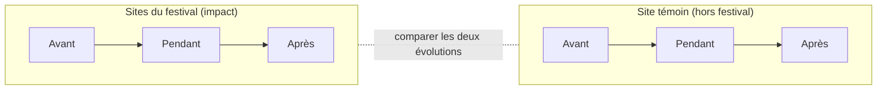
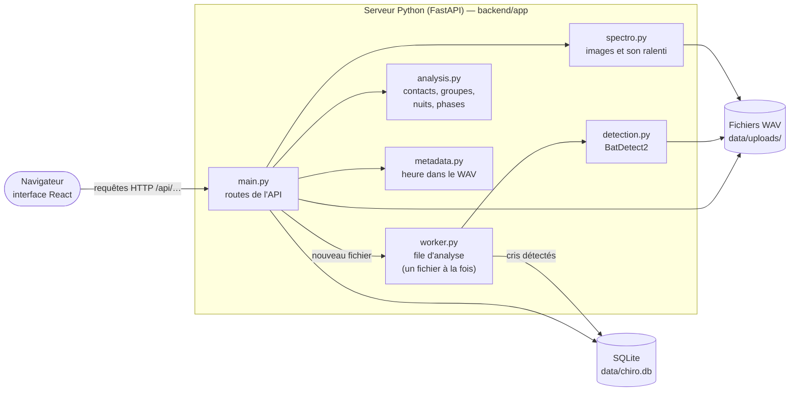
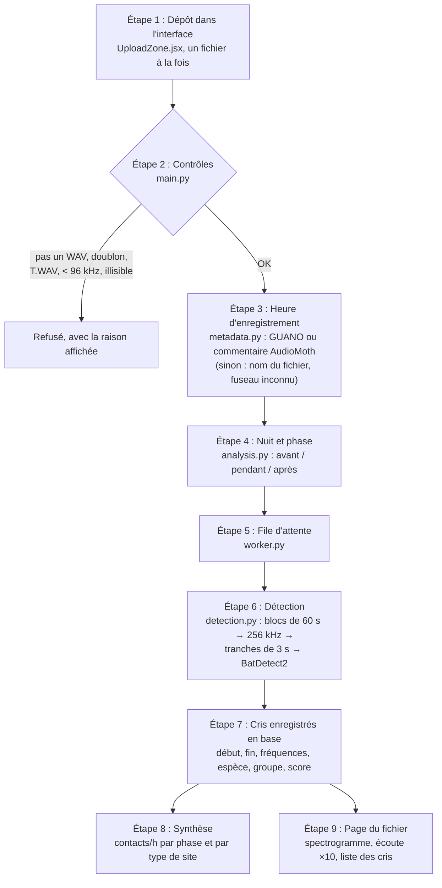
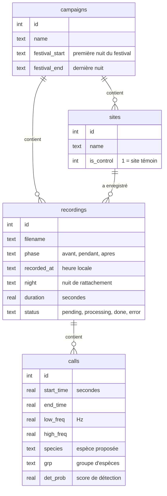

# Chiro Impact

Outil de l'association **Lagom Natura** pour mesurer l'effet d'un festival sur l'activité des chauves-souris.

On pose des enregistreurs d'ultrasons (AudioMoth) **avant, pendant et après** le festival, sur des sites du festival
et sur un **site témoin** loin du bruit. On dépose les fichiers WAV dans l'outil. Il repère les cris de chauves-souris
avec [BatDetect2](https://github.com/macaodha/batdetect2), puis calcule :

- l'**activité** : nombre de **contacts par heure** ;
- la **diversité** : les **groupes d'espèces** présents (Pipistrelles, Myotis, Noctules / Sérotines, Oreillards,
  Barbastelle, Rhinolophes).

> [!WARNING]
> **Ce que l'outil ne fait pas**
> - Il ne compte pas des individus : dix passages d'une même chauve-souris donnent dix contacts.
> - Il n'identifie pas les espèces françaises de façon fiable : le modèle a été entraîné au Royaume-Uni.
>   Les espèces proposées sont des indications à faire confirmer par un spécialiste.
> - Il ne prouve pas statistiquement un impact. Il donne des chiffres descriptifs (voir [Limites](#7-limites-connues)).

---

## Sommaire

1. [Le principe en un schéma](#1-le-principe-en-un-schéma)
2. [Installer (Windows)](#2-installer-sur-windows)
3. [Lancer](#3-lancer)
4. [Utiliser](#4-utiliser)
5. [Comment ça marche (pour les curieux et les développeurs)](#5-comment-ça-marche)
6. [Développer](#6-développer)
7. [Limites connues](#7-limites-connues)
8. [Licences et citation](#8-licences-et-citation)

---

## 1. Le principe en un schéma

On compare **deux évolutions** : celle des sites du festival et celle du site témoin. C'est le plan **BACI**
(*Before / After × Control / Impact*).



- Si l'activité **baisse sur les sites du festival** pendant qu'elle **reste stable au témoin**, le festival est un
  suspect sérieux.
- Si elle **baisse partout**, la cause est sans doute ailleurs : météo, saison, lune…
- Sans site témoin, on ne peut pas faire la différence. L'outil affiche donc toujours le festival et le témoin
  **séparément**.

**Exemple** (campagne de démonstration fournie avec l'outil) :

| | Avant | Pendant | Après |
|---|---|---|---|
| Sites du festival | 720 contacts/h | **240 contacts/h** | 720 contacts/h |
| Site témoin | 720 contacts/h | 720 contacts/h | 720 contacts/h |

### Qu'est-ce qu'un « contact » ?

On découpe l'enregistrement en **tranches de 5 secondes**. Une tranche qui contient **au moins un cri** compte pour
**1 contact**, qu'il y ait 1 cri ou 40. C'est l'unité utilisée par le programme national
Vigie-Chiro ([vigienature.fr](https://www.vigienature.fr)) : elle évite qu'une seule chauve-souris qui chasse
longtemps fasse exploser les chiffres.

```
temps (s)   0         5         10        15        20        25
            |---------|---------|---------|---------|---------|
cris          ▮ ▮▮              ▮                   ▮▮▮▮▮▮▮▮▮
contact ?    OUI       non       OUI       non       OUI          → 3 contacts en 25 s
```

Un cri est retenu si son **score de détection** dépasse **0,3**. Le score va de 0 à 1 et vient du modèle. Ce n'est
pas une probabilité, juste un niveau de confiance. Le curseur de la page d'un fichier permet de voir les cris plus
faibles, sans changer les chiffres.

---

## 2. Installer (sur Windows)

À faire une seule fois.

1. Installer **Python 3.11 ou plus récent** : <https://www.python.org/downloads/>.
   Pendant l'installation, cocher **« Add python.exe to PATH »**.
2. Installer **Node.js 20 ou plus récent**, version « LTS » : <https://nodejs.org>.
3. Double-cliquer sur **`install.bat`**. Compter 5 à 15 minutes : il télécharge PyTorch (~200 Mo), BatDetect2 et
   construit l'interface.

## 3. Lancer

Double-cliquer sur **`start.bat`**. Le navigateur s'ouvre sur <http://localhost:8000>.
Pour arrêter : fermer la fenêtre noire.

Tout reste sur le PC : les fichiers WAV et la base de données sont dans `backend/data/`.

## 4. Utiliser

1. **Créer une campagne** (un festival, une édition). Indiquer les **nuits du festival** : première et dernière
   nuit.
2. **Ajouter les sites** : un par emplacement d'enregistreur, dont **au moins un témoin** hors de la zone du festival.
3. **Déposer les WAV** de la carte SD : choisir le site, puis la phase. **Auto** déduit la phase de la date
   d'enregistrement.
   - Enregistreur AudioMoth réglé à **250 ou 384 kHz**, en **continu ou sur un horaire fixe**.
   - L'heure est lue **dans le fichier** (l'AudioMoth nomme ses fichiers en heure UTC, pas en heure française).
   - Les fichiers en mode déclenché (`…T.WAV`) sont refusés : les silences y sont coupés, ce qui fausserait
     l'activité. Il faut d'abord les « déplier » avec l'application AudioMoth (*File → Expand*).
   - Un fichier déjà déposé sur le même site est ignoré : on peut redéposer toute la carte SD sans risque.
4. **Attendre l'analyse.** Elle va environ 8 fois plus vite que la durée enregistrée sur un PC récent : 1 heure
   d'enregistrement ≈ 7 à 8 minutes.
5. Onglet **Synthèse** : activité du festival et du témoin, phase par phase, et cris par groupe.
6. Onglet **Comparer** : la même comparaison, mais avec des réglages qu'on peut changer pour voir si la conclusion
   tient : seuil de score, durée d'un contact, même plage horaire chaque nuit, sites, nuits à écarter (pluie,
   panne…), groupe d'espèces, contacts ou cris par heure, façon de faire la moyenne. La page affiche l'écart
   d'évolution entre le festival et le témoin, l'activité nuit par nuit, le détail par groupe, et permet de
   **télécharger un CSV par site et par nuit** pour une analyse statistique.
7. **Cliquer sur un fichier** pour voir son spectrogramme, écouter les cris ralentis 10 fois (pour les rendre
   audibles) et vérifier les détections une par une.

Chaque élément de l'interface a une bulle **?** qui l'explique. La page **« Comment ça marche »** de l'outil détaille
la méthode, les limites et les sources. L'interface existe en thème clair et sombre (bouton en haut à droite).

---

## 5. Comment ça marche

### Vue d'ensemble

L'outil est une **application web** : un serveur Python fait les calculs, une interface React s'affiche dans le
navigateur. Sur un PC, les deux tournent sur la même machine.



### Le trajet d'un fichier WAV



### La base de données

Quatre tables dans un seul fichier SQLite :



**Une « nuit »** va de midi à midi : un cri enregistré le 13 juillet à 2 h du matin appartient à la nuit du
12 juillet. C'est ce qui permet de ranger automatiquement chaque fichier dans la bonne phase.

### Les fichiers du projet

```
chiro-impact/
├── install.bat, start.bat     installation et lancement sur Windows
├── backend/                   serveur Python
│   ├── app/
│   │   ├── main.py            toutes les routes de l'API ; sert aussi l'interface compilée
│   │   ├── db.py              base SQLite (création, évolution des tables)
│   │   ├── worker.py          file d'attente des analyses (un « ouvrier » en arrière-plan)
│   │   ├── detection.py       pont vers BatDetect2
│   │   ├── analysis.py        groupes d'espèces, contacts, dates, nuits, phases, résumés
│   │   ├── compare.py         calculs de la page Comparer (réglages, plage horaire, site × nuit)
│   │   ├── metadata.py        lecture de l'heure et du fuseau dans le WAV
│   │   ├── spectro.py         image du spectrogramme et extrait sonore ralenti
│   │   └── config.py          réglages (variables d'environnement)
│   ├── scripts/creer_demo.py  fabrique une campagne de démonstration
│   └── tests/                 53 tests automatiques (pytest)
├── frontend/                  interface web (React + Vite + Tailwind)
│   └── src/
│       ├── pages/             Campagnes, Campagne, Comparer, Fichier (spectrogramme), Comment ça marche
│       ├── components/        en-tête, bulles d'aide, dépôt, sites, dates, synthèse
│       ├── api.js             toutes les requêtes vers le serveur
│       └── theme.js           thème clair / sombre
├── deploy/                    mise en ligne sur un serveur (Docker + Traefik)
├── Dockerfile
└── docs/
    ├── AUDIT.md               relecture complète du projet, choix techniques et limites
    ├── demo_wav/              vrais cris de chauves-souris pour les tests
    └── maquette_chiro_impact.html
```

Le code est commenté bloc par bloc, en français, pour être lu par quelqu'un qui débute.
[`docs/AUDIT.md`](docs/AUDIT.md) explique les choix techniques, avec les sources (documentation et tickets
BatDetect2, firmware AudioMoth, études publiées).

### Quelques notions

| Notion | En clair |
|---|---|
| **Ultrasons** | La plupart des chauves-souris d'Europe crient entre ~10 et ~120 kHz. L'oreille humaine s'arrête vers 20 kHz. |
| **Fréquence d'échantillonnage** | Nombre de mesures du son par seconde. Un fichier à 384 kHz contient les sons jusqu'à 192 kHz (la moitié : c'est la limite de Nyquist). |
| **Spectrogramme** | Image du son : le temps à l'horizontale, la fréquence à la verticale, l'intensité en niveaux de gris. Un cri y apparaît comme un petit trait. |
| **Score de détection** | Nombre de 0 à 1 donné par BatDetect2 pour chaque cri. Seuil retenu : strictement au-dessus de 0,3. |
| **Écoute ralentie ×10** | Ralentir le son 10 fois divise ses fréquences par 10 : un cri à 45 kHz devient audible à 4,5 kHz. |

---

## 6. Développer

### Tests

```bash
cd backend
.venv\Scripts\python -m pip install -r requirements-dev.txt
.venv\Scripts\python -m pytest
```

53 tests, environ 1 min 30. Ils utilisent de vrais cris de chauves-souris (`docs/demo_wav/`) et comparent les
détections de l'outil à celles de BatDetect2 utilisé directement.

### Campagne de démonstration

Serveur lancé (`start.bat`), puis :

```bash
cd backend
.venv\Scripts\python scripts\creer_demo.py
```

### Interface avec rechargement automatique

```bash
cd frontend
npm run dev
```

L'interface s'ouvre sur <http://localhost:5173>. Le serveur Python doit tourner sur le port 8000 (`start.bat`).
Après une modification de l'interface, `npm run build` met à jour la version servie par `start.bat`.

### Réglages

Variables d'environnement lues par `backend/app/config.py` :

| Variable | Défaut | Rôle |
|---|---|---|
| `CHIRO_DATA_DIR` | `backend/data` | Dossier de la base et des WAV |
| `CHIRO_THREADS` | moitié des cœurs du processeur | Cœurs utilisés par l'analyse |
| `CHIRO_TZ` | `Europe/Paris` | Fuseau horaire d'affichage |
| `CHIRO_MIN_SAMPLERATE` | `96000` | Fréquence d'échantillonnage minimale acceptée (Hz) |

### Mise en ligne

L'image Docker contient tout : interface compilée, serveur et BatDetect2 (PyTorch version processeur).

```bash
docker build -t chiro-impact .
```

Sur un serveur équipé de Traefik, voir [`deploy/docker-compose.yml`](deploy/docker-compose.yml). L'accès est protégé
par un identifiant et un mot de passe, stockés dans un fichier `deploy/.env` qui n'est jamais commité.

---

## 7. Limites connues

Détail complet dans [`docs/AUDIT.md`](docs/AUDIT.md). Les principales :

- **Pas encore de preuve statistique.** L'export **par site et par nuit** existe (page Comparer) ; le modèle
  statistique (comptages, effet « phase × type de site ») reste à faire, par exemple dans R.
- **Plage horaire non contrôlée.** L'activité est divisée par la durée des fichiers. C'est juste si l'enregistreur
  couvre la même plage chaque nuit (par exemple du coucher du soleil −30 min au lever +30 min).
- **Plusieurs nuits par phase** sont nécessaires (au moins 3 à 5), et la **météo** de chaque nuit compte beaucoup.
- **Contacts tous groupes confondus** : les effets peuvent différer selon les groupes d'espèces.
- **Pas encore d'outil pour écarter un faux cri** (« ce n'est pas une chauve-souris »).
- **Modèle entraîné au Royaume-Uni** : 17 espèces britanniques, aucune évaluation publiée sur des données françaises
  à notre connaissance.

---

## 8. Licences et citation

- **BatDetect2** (code et modèle) : licence **CC BY-NC 4.0**, usage **non commercial** uniquement.
  Si l'étude est rémunérée (par exemple par l'organisateur du festival), demander l'accord des auteurs.
  À citer : Mac Aodha O. et al. (2022), *Towards a general approach for bat echolocation detection and
  classification*, bioRxiv, [doi:10.1101/2022.12.14.520490](https://doi.org/10.1101/2022.12.14.520490).
- **Code propre à Chiro Impact** : licence **MIT** (voir [`LICENSE`](LICENSE)). Elle ne couvre que ce code :
  utiliser l'outil reste soumis à la licence de BatDetect2 ci-dessus.
